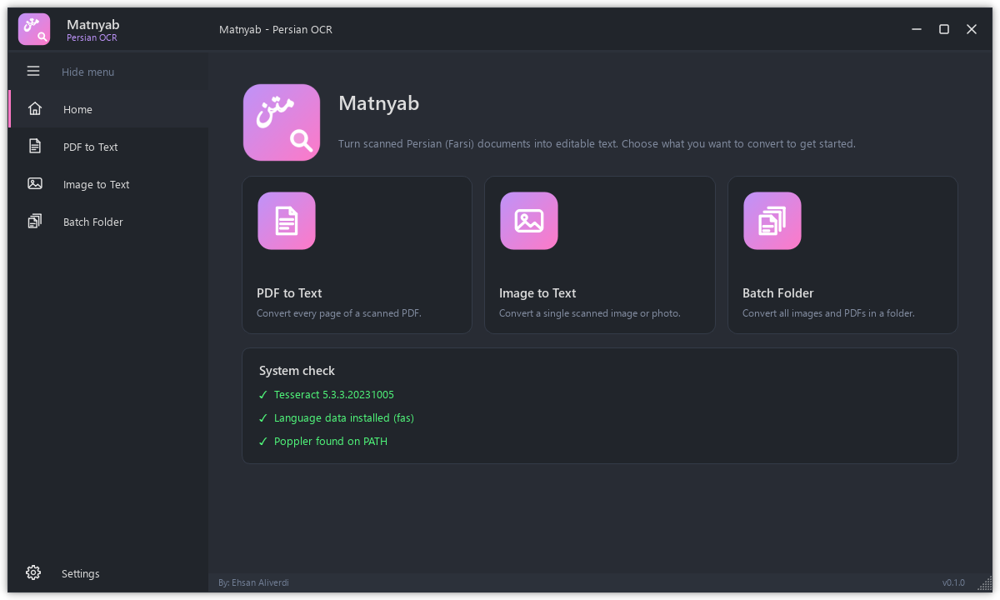
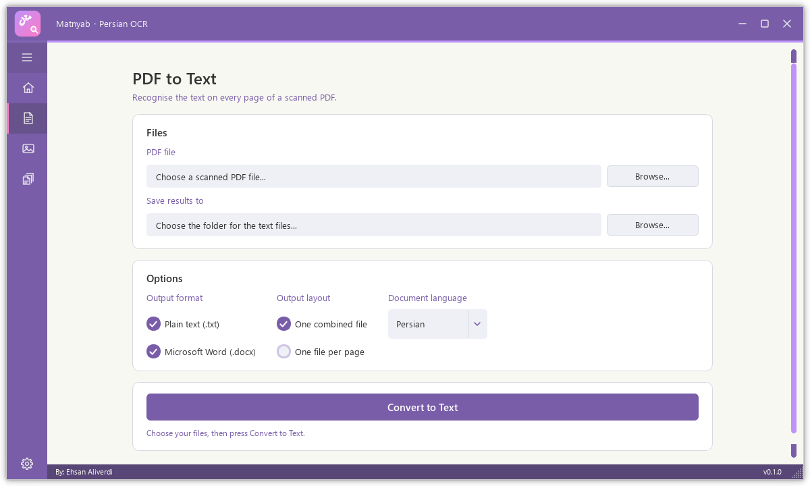
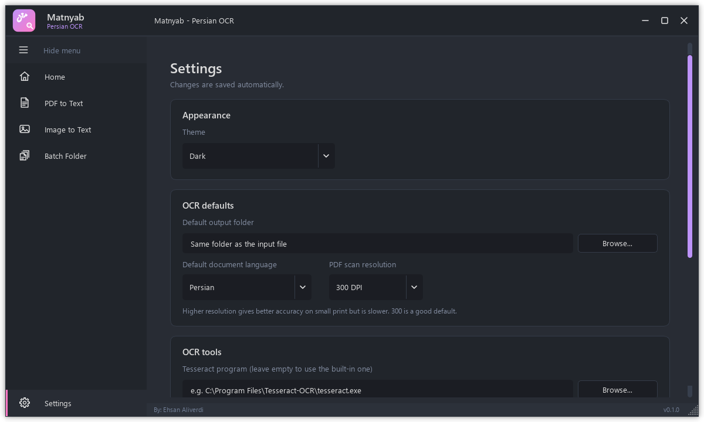

# Matnyab (متن‌یاب)

**Turn scanned Persian (Farsi) documents into text you can edit.**

Matnyab is a free Windows app. Give it a scanned PDF, a photo of a page, or a whole folder of
scans, and it reads the Persian text and saves it as a Word document (`.docx`) and/or a plain
text file (`.txt`). It works offline: your documents never leave your computer.



## Install

1. Go to the [latest release](https://github.com/EhsanAliverdi/matnyab/releases/latest).
2. Download **`Matnyab-Setup-<version>.exe`** under *Assets*.
3. Run it and follow the steps. You can install it just for yourself (no administrator rights
   needed) or for everyone on the computer.

That's all. Everything Matnyab needs, including the Tesseract text-recognition engine and the
tools for reading PDFs, is included in the installer.

> **Windows warning?** Because the installer isn't code-signed yet, Windows SmartScreen may say
> it "protected your PC". Click **More info**, then **Run anyway**.

**Requirements:** Windows 10 or 11, 64-bit. About 400 MB of disk space.

**To uninstall:** Windows **Settings → Apps**, find **Matnyab**, choose **Uninstall**.

## How to use it

Open Matnyab from the Start menu. The side menu has one page for each kind of input; click
the ☰ button at the top to show the page names.



### Convert a scanned PDF

1. Click **PDF to Text**.
2. Next to **PDF file**, click **Browse...** and choose your PDF.
3. **Save results to** fills in with the PDF's folder. Click **Browse...** to choose another one.
4. Choose your options (see below) and click **Convert to Text**.
5. Wait for the progress bar to finish, then click **Open output folder**.

### Convert a single image

Same steps on the **Image to Text** page. PNG, JPG and TIFF images work, including photos of
pages taken with a phone.

### Convert a whole folder

On the **Batch Folder** page, choose a folder instead of a file. Matnyab converts every image
and PDF in that folder (not in its sub-folders), and each file gets its own result.

### Options

| Option | What it does |
|---|---|
| **Plain text (.txt)** | Saves the text as a simple text file. |
| **Microsoft Word (.docx)** | Saves the text as a Word document, one page per scanned page. |
| **One combined file** | Puts all pages of a document into one file. |
| **One file per page** | Also saves each page separately, in `… Plain Text` and `… MS Word` folders. |
| **Document language** | The language printed on the page: Persian, Persian + English (for mixed text), Arabic or English. |

The results are saved in the output folder, named after your input file.

## Tips for the best results

- **Scan at 300 DPI or higher.** Blurry or very small text is the main cause of mistakes.
- **Keep pages straight and well lit.** Crop away dark edges, fingers and the facing page.
- **Pick the right language.** Use *Persian + English* when a page mixes both scripts.
- **For PDFs with small print**, raise **PDF scan resolution** in Settings to 400 or 600 DPI.
  It's slower but more accurate.
- **Always proofread.** OCR is never perfect, especially with old, decorative or handwritten
  text.

Each page takes a few seconds, so a 100-page book takes several minutes. You can switch to
other pages of the app while it works.

## Settings



- **Theme:** dark or light.
- **Default output folder:** where results go unless you choose another folder. Leave it
  empty to save next to the input file.
- **Default document language:** the language selected when the app opens.
- **PDF scan resolution:** higher is more accurate on small print but slower. 300 DPI suits
  most documents.
- **OCR tools:** leave these empty to use the built-in Tesseract and Poppler. Only change them
  if you want to use your own installed copies.

Settings are saved automatically.

## Troubleshooting

**The Home page shows a red ✗ in "System check".**
The installed app includes everything, so this normally means a custom path was set in
**Settings → OCR tools**. Clear both fields to go back to the built-in tools, then click
**Check again**.

**"Conversion failed" appears.**
Check that the file opens normally in another program, isn't password-protected, and that you
can save files in the output folder. Then try again.

**The text has lots of mistakes.**
See [Tips for the best results](#tips-for-the-best-results). The quality of the scan matters most.

**Something else is wrong?**
[Open an issue](https://github.com/EhsanAliverdi/matnyab/issues) and describe what you did,
what you expected and what happened. A sample page helps a lot, if it isn't private.

---

## For developers

### Run from source

You need Python 3.9 or newer,
[Tesseract](https://github.com/UB-Mannheim/tesseract/wiki) with the `fas` language data, and
[Poppler](https://github.com/oschwartz10612/poppler-windows/releases). Both tools should be on
your `PATH`, or set their locations in the app's Settings page.

```console
pip install -r requirements.txt
python main.py
```

### Project layout

| Path | What it is |
|---|---|
| `main.py` | Entry point: main window, navigation, themes, running OCR jobs |
| `main.ui` | Qt Designer layout of the window shell (compiled to `modules/ui_main.py`) |
| `modules/pages.py` | Home, PDF, Image, Batch and Settings pages |
| `modules/config.py` | Saved settings, app version, and checks for Tesseract / Poppler |
| `modules/OCR/src/ocr.py` | OCR pipeline: PDF → images → preprocessing → Tesseract → txt/docx |
| `modules/OCR/src/preprocess.py` | OpenCV image clean-up |
| `modules/worker.py` | Background worker so the window stays responsive |
| `themes/` | Qt stylesheets for the dark and light themes |
| `tools/make_icons.py` | Draws the logo, `icon.ico` and every UI icon in one shared style |
| `packaging/` | PyInstaller spec, Inno Setup script and build script for the installer |
| `.github/workflows/release.yml` | Builds and publishes the installer on GitHub |

### Change the UI, icons or resources

After editing `main.ui`, `resources.qrc` or anything in `images/`:

```console
python tools/make_icons.py
pyside6-rcc resources.qrc -o modules/resources_rc.py
pyside6-uic main.ui -o modules/ui_main.py
```

Then change `import resources_rc` at the top of `modules/ui_main.py` to
`from .resources_rc import *`.

### Publish a new version

1. Set `APP_VERSION` in `modules/config.py`, for example `0.2.0`, and commit.
2. Tag the commit and push the tag:

   ```console
   git tag v0.2.0
   git push origin v0.2.0
   ```

GitHub Actions then builds the app, tests the packaged build on a sample PDF
(`Matnyab.exe --self-test`), and publishes a release with the installer attached. It refuses
to publish if the tag doesn't match `APP_VERSION`.

### Build the installer on your own PC

You need Python 3.9, Tesseract (with `fas`, `ara`, `eng` and `osd` data), Poppler, and, for the
installer step, [Inno Setup 6](https://jrsoftware.org/isinfo.php):

```console
python -m venv .venv
.venv\Scripts\pip install -r requirements-build.txt
.venv\Scripts\python packaging\build.py --poppler-dir "C:\path\to\poppler\Library\bin"
```

The app is written to `dist\Matnyab\` and the installer to `dist\Matnyab-Setup-<version>.exe`.

## Credits

- Window design based on
  [PyDracula](https://github.com/Wanderson-Magalhaes/Modern_GUI_PyDracula_PySide6_or_PyQt6)
  by Wanderson M. Pimenta (MIT, see `LICENSE`).
- OCR pipeline based on FarsiOCR by Sajedeh Tafazzoli (MIT, see `modules/OCR/LICENSE`).
- Text recognition by [Tesseract OCR](https://github.com/tesseract-ocr/tesseract); PDF reading
  by [Poppler](https://poppler.freedesktop.org/). See
  [packaging/THIRD_PARTY_NOTICES.md](packaging/THIRD_PARTY_NOTICES.md) for everything bundled
  in the installer.

Made by Ehsan Aliverdi.
